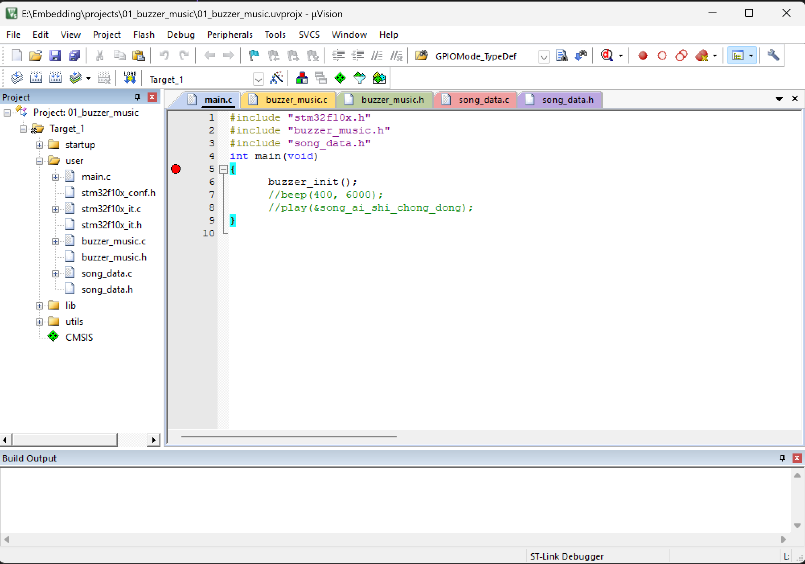

# 文件管理
文件管理应该是我的短板，一直以来我都是直接全部稀里糊涂的都堆在一个文件夹里面，如果内容少一点还好，但是东西稍微多一点简直就是灾难了。

gemini，*讲解下一个基本的c语言工程该如何建立正确的文件结构*：

>建立一个清晰、规范的 C 语言工程文件结构，是保证代码可维护性和可扩展性的核心。无论是小型练习还是大型项目，将源码、头文件、编译产物和第三方库分离是通用的最佳实践。
>以下是标准的 C 语言项目目录结构：
>```
>my_c_project/
>├── bin/            # 存放最终生成的可执行文件 (Executable)
>├── build/          # 存放编译时产生的中间文件 (.o 目标文件)
>├── include/        # 存放项目所有的公共头文件 (.h)
>├── src/            # 存放所有的源文件 (.c)
>├── tests/          # 存放测试代码
>├── lib/            # 存放第三方库或依赖 (Vendor/Third-party)
>├── docs/           # 项目说明文档、API文档
>├── .gitignore      # 配置 Git 忽略的文件 (如 bin/ 和 build/)
>├── Makefile        # 构建脚本 (或者使用 CMakeLists.txt)
>└── README.md       # 项目的总体说明
>```

**~~叽里咕噜说啥呢，我都是直接放在一个文件夹的~~**

不能这样的，这样的话上午做的东西下午连文件在哪都不知道了。


这个看起来很有序是吧，但是其实是ai整理的。
总不能每次搞得一团乱码再交给ai处理烂摊子吧。

所以还是来认真学习下文件的架构。

为了用git高效的管理项目，文件根据大小基本可以分为两类：
- 大文件：可执行文件（bin）和编译中间产物（build）
- 小文件：源代码，文档，readme，依赖
好像还满简单的吧。但是如果出现了不在这一分类下的咋办呢。比如一个pdf技术文档很大，而有些编译中间产物还蛮小的……

思考🤔
感觉有两种方案：
1. 保持原有结构，当作例外处理 
2. 管他这那的，反正太大的一律gitignore，需要例外的情况就用其他的来管理

那当然是第二种啦，git就是用来追踪纯文本等小文件来管理版本的，如果不小心塞太多东西进去的话……已经提交到git上的文件将会很难清除的。~~git push -f origin main~~

自己的仓库还可以这么干，但是如果要和别人协作的话，还是一开始就别提交大文件上去吧。切记。


# 头文件

简单学下头文件要放什么东西，不要每次建了就发懵，然后东西.c .h这写一点那写一点, 搞出来一堆redefine error，还不如最开始全部写到main里面呢。（详见嵌入式笔记2）
## 1. 头文件保护
```c
#ifndef PROJECT_MODE_H
#define PROJECT_MODE_H

#endif
```
这样就不会出现重复定义的头文件了。

## 2.  定义only
在头文件当中是用来放定义来方便编译器编译的，同时也作为对外的声明让别人知道这里有什么。所以里面一般来说就是：
- 函数声明（如 `void do_something();`）
    
- 外部变量声明（如 `extern int count;`）
    
- 结构体/枚举声明（如 `struct Node { ... };`）
    
- 宏定义和 `typedef`

## 3. 自包含
这个不常听到，但是其实就是这个头文件里面的声明用到的其他头文件提前在这个头文件当中#include进去，这样其他文件需要用到的时候只要include这个头文件就ok了，不需要去猜还要放什么其他依赖进来。

ok，这下应该就好了。
如果还是读不懂那么就不是我的问题了。


~~(等下，这个图片好大欸，我真的要把它推送到github上面吗？)~~
好了，压缩成webp格式了，实践大成功。