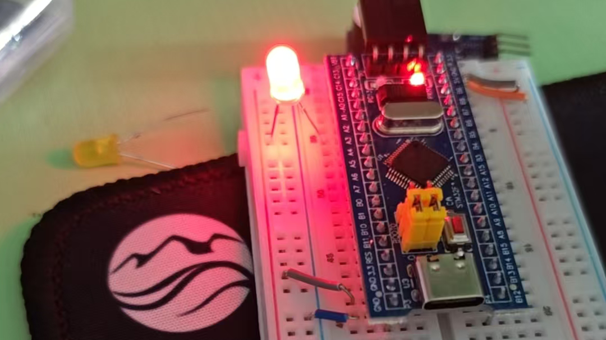

# GPIO和点亮第一个LED

其实我也不是很能搞明白具体这些步骤，总之先写下来

GPIO启用时钟：

```c
RCC_APB2PeriphClockCmd(RCC_APB2Periph_GPIOA, ENABLE);

//参考下函数定义->
/**
  * @brief  Enables or disables the High Speed APB (APB2) peripheral clock.
  * @param  RCC_APB2Periph: specifies the APB2 peripheral to gates its clock.
  *   This parameter can be any combination of the following values:
  *     @arg RCC_APB2Periph_AFIO, RCC_APB2Periph_GPIOA, RCC_APB2Periph_GPIOB,
  *          RCC_APB2Periph_GPIOC, RCC_APB2Periph_GPIOD, RCC_APB2Periph_GPIOE,
  *          RCC_APB2Periph_GPIOF, RCC_APB2Periph_GPIOG, RCC_APB2Periph_ADC1,
  *          RCC_APB2Periph_ADC2, RCC_APB2Periph_TIM1, RCC_APB2Periph_SPI1,
  *          RCC_APB2Periph_TIM8, RCC_APB2Periph_USART1, RCC_APB2Periph_ADC3,
  *          RCC_APB2Periph_TIM15, RCC_APB2Periph_TIM16, RCC_APB2Periph_TIM17,
  *          RCC_APB2Periph_TIM9, RCC_APB2Periph_TIM10, RCC_APB2Periph_TIM11   
  * @param  NewState: new state of the specified peripheral clock.
  *   This parameter can be: ENABLE or DISABLE.
  * @retval None
  */
void RCC_APB2PeriphClockCmd(uint32_t RCC_APB2Periph, FunctionalState NewState);
```

然后是初始化GPIO：
*这里有一个GPIO初始化结构体需要添加一些具体参数*

```c
GPIO_Init(GPIOA, &GPIO_InitStructure0);
/**
  * @brief  Initializes the GPIOx peripheral according to the specified
  *         parameters in the GPIO_InitStruct.
  * @param  GPIOx: where x can be (A..G) to select the GPIO peripheral.
  * @param  GPIO_InitStruct: pointer to a GPIO_InitTypeDef structure that
  *         contains the configuration information for the specified GPIO peripheral.
  * @retval None
  */
void GPIO_Init(GPIO_TypeDef* GPIOx, GPIO_InitTypeDef* GPIO_InitStruct);
```

再来看下结构体,定义在这里：

```c
typedef struct
{
  uint16_t GPIO_Pin;
  /*GPIO_Pin_0 ~ 15 or ALL*/  
  GPIOSpeed_TypeDef GPIO_Speed;
  /*
  GPIO_Speed_10MHz = 1,
  GPIO_Speed_2MHz, 
  GPIO_Speed_50MHz*/
  GPIOMode_TypeDef GPIO_Mode;  
  /*
  GPIO_Mode_AIN = 0x0,
  GPIO_Mode_IN_FLOATING = 0x04,
  GPIO_Mode_IPD = 0x28,
  GPIO_Mode_IPU = 0x48,
  GPIO_Mode_Out_OD = 0x14,
  GPIO_Mode_Out_PP = 0x10,
  GPIO_Mode_AF_OD = 0x1C,
  GPIO_Mode_AF_PP = 0x18*/  
}GPIO_InitTypeDef;
```

有了定义初始化就简单了，

```c
GPIO_InitTypeDef GPIO_Initstructure0;
	GPIO_Initstructure0.GPIO_Mode = GPIO_Mode_Out_PP;
	GPIO_Initstructure0.GPIO_Pin = GPIO_Pin_0;
	GPIO_Initstructure0.GPIO_Speed = GPIO_Speed_50MHz;
```

~~LED灯默认是低电平点亮~~ 哦不，其实是和推挽输出相关的，所以点亮操作只需要设置设定好的输出引脚电平就可以

```c
	GPIO_ResetBits(GPIOA, GPIO_Pin_0);//设置输出位为低
	GPIO_SetBits(GPIOA, GPIO_Pin_0);//设置输出位为高
	GPIO_WriteBit(GPIOA, GPIO_Pin_0, Bit_SET);
	GPIO_WriteBit(GPIOA, GPIO_Pin_0, Bit_RESET);//写入低/高
```

这样就可以亮了。

**其实并不能**

因为接线还没有搞定，所以单这些代码没有什么用。这时候需要将
led的负极连接pin0，然后正极（长脚）连接供电（最上面红色一排）。然后将GND引脚接地（最上面蓝色一排），3.3v连接供电，这下终于可以亮了，简单。

