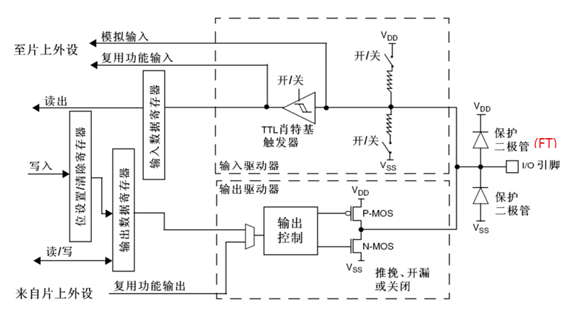

试图去点亮oled屏幕结果大败而归了。有可能是驱动问题，但是既然屏幕都点不亮那也有可以是其他线路电压上的问题吧。也许下一篇笔记就会写关于如何处理屏幕了（前提是我能够找到问题）。

回归正题，既然屏幕搞不定那就先去尝试下无源蜂鸣器好了。无源蜂鸣器比有源的相对要难一点，因为没有自带的震荡源，需要输出方波发声。

先来看下硬件原理：
>首先我们需要了解的是KC-1206电磁式无源蜂鸣器是如何工作的。这款蜂鸣器采用了一种独特的设计，在5V电压下可以发出高达85dB的声音，这足以应对大多数室内或户外场景中的报警或提示需求。其内部构造包括磁路系统和振动膜片，当电流通过线圈产生磁场时，会带动周围的磁铁振动，从而引发空气震动形成声音。

目前用的这个小程序是用翻转引脚电极的方式进行驱动，其实标准的话应该是使用定时器生成的PWM（脉宽调制）信号进行驱动，但是那个稍微有点复杂改日再学。

OK，那么只要输出一个能让蜂鸣器响的方波信号就可以对吧。

但是问题来了，stm32引脚的最大输出电流也就大概25mA，一般在8mA左右，该如何驱动30mA以上工作电流的蜂鸣器呢？
（**做的时候没有思考这个问题，查资料才发现如果我直接将裸蜂鸣器接入系统板的话我的板子就烧了。** 下次做不熟悉的硬件模块还是要仔细查完资料原理再动手。）反转了，stm32f103的GPIO有保护二极管，所以还是安全的。

答案还是要从底层原理去找。从电压的角度来看，我现在用的这个开发板是最小开发板所以没有其他外设，电源（5v）从stlink调试器当中接入到板上，经过~~稳压器~~
哦不对稳压芯片，变成3.3v之后接入主板，在这个场景下进入GPIO模块（GPIO：General Purpose Input Output），是这样吗？




看上图的GPIO基础原理图，V<sub>DD</sub>接入的地方有三个，保护二极管（当IO引脚电压大于V<sub>DD</sub>的时候导通降压），输入的上拉电阻（在输入悬空/没有输入的时候当中拉高高电位电压，输入的时候提供稳定的高电平），**还有输出的P-MOS**， 这次学习的重点就是这个。


>**P‑MOS 是一种以空穴为主要载流子的 P 沟道 MOSFET，通常用于高端开关，其导通条件为栅源电压 VGS 为负且低于阈值（例如约 −0.4V）。**

栅源接的是GPIO的输出控制，记得前面上拉电阻将高电平拉高为3.3v了嘛，所以导通条件就变成低电平了。所以这就是为啥推挽输出设置的时候，低电平能够点灯了（之前不懂欸）。不过重点在于是，这里电压是直接从P-MOS直接导通到输出的，并不是用芯片输出的高电平直接驱动。

**总结下：** 电源 -> 主板V<sub>DD</sub> -> 输出
这一条路下来，输出的引脚就变成3.3v了。

欸，记得前面提到过无源蜂鸣器是电磁驱动的，那么其实就是一个大电感嘛，回忆下高中电路知识，电感低阻高抗，那么
$$
\frac{3.3v}{x}  > 30mA
$$

很明显只要x比较小的时候电流就足够驱动蜂鸣器了。大成功。

但是为啥差点烧了也就是因为这个电感，当输出低电平的时候，电感产生反向电动势，电压很大可能就会把MOS管烧了（如果没有保护二极管的话）。

## 硬件部分的学习结束<sub></sub>

来看下软件的代码实现。我的目标是用这个无源蜂鸣器播放一个歌曲，歌曲midi已经预先用ai处理为以下的结构：
```c
typedef struct {
	u16 freq;//frequency in HZ
	u16 duration_ms;
} note;

typedef struct song {
	const char *name;
	u16 note_count;
	const note *notes;
} song;
```

看下实际曲目的代码片段
```c
static const note song_ai_shi_chong_dong_notes[] = {
    {    0, 2667}, {  247,  300}, {    0,   25}, {  277,  335},
/*^_^*/
```

思考一下，该怎么实现呢？

回顾一下，蜂鸣器发声的方式是通过方波发出特定频率的震动，
$$
frequency = \frac{1}{cycles/s}
$$
所以需要计算每秒钟的周期数还有每个周期的时长
```c
long period_us = 1000000 / fre;
long half_period_us = period_us / 2;
long cycles = ((long) fre * duration_ms) / 1000;
```
这样的话，对于每一个循环都有：
	第一个半周期，高电平
	第二个半周期，低电平
同时再计算每个音有多少个循环存在

很简单吧。

然后就搞定延时模块就可以了。延时这一块没有自己写，用的是网上的翻转IO模板。
看下.h文件的说明
```c
/*
 * 基于 SysTick 的轮询式延时（不使用中断，不占用定时器）。
 * 提供通用 delay_us / delay_ms，任何工程都可以用。
 *
 * delay_init() 必须在第一次调用 delay_ms/delay_us 之前执行一次，
 * 否则延时长度不正确（内部倍乘数还是 0）。
 * 因为它要读 SystemCoreClock，请放在时钟/RCC 初始化之后调用。
 */
void delay_init(void);
void delay_us(u32 nus);
void delay_ms(u16 nms);
```
那么对于一个周期就只要在每个半周期开始时候调用：
```c
delay_us((u32)half_period_us);
```
就好了。

别忘了GPIO初始化，根据之前硬件分析知道要用推挽输出，然后就是前面的笔记写到的那样 启用时钟 -> 定义Init结构体+参数 -> 调用初始化函数

等下 是不是忘记什么了
> ```c
> /* delay_init() 必须在第一次调用 delay_ms/delay_us 之前执行一次，
> * 否则延时长度不正确（内部倍乘数还是 0）。
 >* 因为它要读 SystemCoreClock，请放在时钟/RCC 初始化之后调用。
 >*/
 >```

还有delay模块也需要初始化哦。

这样一个音如何发出来的部分就已经搞定了，接下来顺势就把音乐给用一个函数给实现了吧。

>```c
>typedef struct song {
>	const char *name;
>	u16 note_count;
>	const note *notes;
>} song;
>```

这个是结构体的基本结构，很明显，只需要用一个循环次数等于音符数的循环体来实现，其中每次调用前面写好的发音函数就ok了。

```c
void play(const song* name){
	/* 遍历 name->notes[0..note_count-1], freq==0 时 delay_ms(duration_ms), 否则 beep(freq, duration_ms) */
	int cnt = name->note_count;
	for(int i = 0; i < cnt; ++i){
		int fre = name->notes[i].freq;
		int time = name->notes[i].duration_ms;
		if(fre == 0) delay_ms(time);
		else beep(fre,time);
	}
	 GPIO_ResetBits(GPIOA, BUZZER_PIN); 
}
```
## 核心代码到此结束


但是如何组织代码呢，感觉上来说还是蛮简单的
>\---buzzer_music.c
>|--buzzer_music.h
>|--song_data.c
>|--song_data.h


用buzzer_music 用来存放蜂鸣器初始化和发声还有播放功能，然后把预先准备好的song_data数据导入进去，这下就差不多可以了。

但是在实操的时候还是存在问题，在处理song这个结构体的时候我试图在buzzer_music.c 当中定义一个结构体来指向我的歌曲，全然忘记我在写play这个函数的时候定义了个指针并且意在指向我预先编好的歌曲数据。

毫不意外的，出现了redefined error（忏悔……）

其实最开始结构体的定义是写在buzzer_music.c 里面的，这个还会导致结构体不对song_data公开，还会出现undefined error，谨慎谨慎。

总之，搞定完这些之后，非常顺利的蜂鸣器就能响了，是吗？

no，这次的硬件接线并没有上次点灯那样顺利。其实我个人来说不是很知道具体该如何给硬件接线，于是直接照葫芦画瓢的按照上次点灯那样，将蜂鸣器插在面包板上然后连接，但是奇怪的是并没有响，用万用表一看发现蜂鸣器的signal脚和GND脚之间的电压是0.3v。奇怪，是中间有线接触不良然后断联了吗？

（*跳过两个小时的垃圾时间）

原来是面包板本身的接触电阻过大了，加上一系列的导线导致驱动电流根本不够，我用杜邦线直接接着蜂鸣器去触碰系统板的正极和地线可以听到咔哒的声音，就说明不是蜂鸣器的问题。但是这样就已经浪费了好多时间了，改为用杜邦线后就很顺利的驱动成功了。

顺利结束。✌